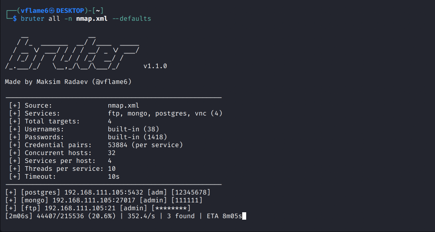

<h1 align="center">
  bruter
</h1>

<h4 align="center">The widest-coverage network brute-forcer — 56 protocols in one static Go binary, driven straight from your nmap, Nessus and Nexpose scans.</h4>

<p align="center">
<a href="https://github.com/vflame6/bruter/actions/workflows/ci.yml"></a>
<a href="https://goreportcard.com/report/github.com/vflame6/bruter" target="_blank"></a>
<a href="https://codecov.io/gh/vflame6/bruter"></a>
<a href="https://github.com/vflame6/bruter/releases"></a>
<a href="https://github.com/vflame6/bruter/blob/main/LICENSE"></a>
<a href="https://github.com/vflame6/bruter/issues"></a>
<a href="https://t.me/vflame6"></a>
</p>

Created by Maksim Radaev/[@vflame6](https://github.com/vflame6)

---

Point `bruter` at an nmap, Nessus or Nexpose file and it figures out which of its
56 protocol modules to run against every service in it. No Python, no plugin
directory, no per-service invocation — one static binary that reaches modern
data stores and C2 panels as readily as it does SSH.

> `bruter` is for authorized security testing only: systems you own, or systems
> you have explicit written permission to test. Using it against anything else
> is likely illegal.

## Why bruter

- **Lockout-safe spraying.** `--spray` tries one password across every account
  *and every host*, sleeps, then moves on. With
  `--max-attempts-per-user` it aborts before the domain locks out.
- **One command for a whole scan.** `bruter all -n scan.xml --defaults` maps
  every discovered service to a module and runs them concurrently.
- **56 protocols**, from SSH and SMB through to ClickHouse, Cassandra, Neo4j,
  etcd, InfluxDB, CouchDB, Elasticsearch, Vault, AMQP, SMPP and Cobalt Strike
  team servers.
- **Kerberos.** AS-REQ pre-authentication spraying and user enumeration, the
  first and last things an AD tester runs.
- **Finds misconfigurations, not just passwords.** `--vulns` checks null
  sessions, anonymous binds, no-auth data stores and vendor defaults without
  firing a single wordlist attempt.
- **Resumable.** `--resume state.ck` and a run that dies at hour six picks up
  where it stopped.
- **Static binary.** `apt install`, `brew install`, or drop the release binary
  on a jump host. Nothing to install alongside it.

## Modules

Modern data stores, message brokers and C2 panels:

| Module | Service | Default port |
|--------|---------|--------------|
| `clickhouse` | ClickHouse native protocol | 9000 |
| `cassandra` | Apache Cassandra CQL | 9042 |
| `neo4j` | Neo4j Bolt protocol | 7687 |
| `etcd` | etcd v3 | 2379 |
| `influxdb` | InfluxDB | 8086 |
| `couchdb` | Apache CouchDB | 5984 |
| `elasticsearch` | Elasticsearch | 9200 |
| `vault` | HashiCorp Vault userpass | 8200 |
| `amqp` | AMQP 0-9-1 / RabbitMQ | 5672 |
| `smpp` | SMPP (SMS gateways) | 2775 |
| `cobaltstrike` | Cobalt Strike team server | 50050 |

Everything else:

| Category | Modules |
|----------|---------|
| **Remote Access** | `ssh`, `sshkey`, `rdp`, `winrm`, `telnet`, `rexec`, `rlogin`, `rsh`, `vnc`, `radmin`, `vmauthd` |
| **Databases** | `mysql`, `mssql`, `postgres`, `oracle`, `mongo`, `redis`, `firebird`, `memcached` |
| **Mail** | `smtp`, `smtp-enum`, `imap`, `pop3`, `nntp` |
| **Web / HTTP** | `http-basic`, `http-form`, `http-proxy` |
| **Active Directory** | `kerberos`, `kerberos-enum`, `ldap` |
| **File Sharing** | `ftp`, `smb`, `svn` |
| **Messaging** | `irc`, `xmpp` |
| **Network** | `socks5`, `snmp`, `rtsp`, `rpcap` |
| **VoIP** | `asterisk`, `teamspeak`, `sip` |
| **Cisco** | `cisco`, `cisco-enable` |
| **Industrial** | `s7` |

`bruter -L` lists every module with its default port.

### Vulnerability checks

`--vulns` runs authentication-bypass checks and vendor default credentials
*instead of* a wordlist — useful as a first, quiet pass. It covers SMB null
sessions, LDAP anonymous binds, unauthenticated Redis/Mongo/etcd/CouchDB/
Elasticsearch/InfluxDB/Memcached/Neo4j/Cassandra, PostgreSQL trust auth, empty
`sa`/`root` passwords, FTP anonymous login, Cisco and Telnet passwordless
logins, SNMP default communities, and `ssh-hole` — the OpenSSH/musl overlong
password bypass, probed on the `ssh` module.

## Installation

### Debian, Ubuntu, Kali

```shell
VER=$(curl -fsSL https://api.github.com/repos/vflame6/bruter/releases/latest | sed -n 's/.*"tag_name": *"v\([^"]*\)".*/\1/p')
curl -fsSLO "https://github.com/vflame6/bruter/releases/download/v${VER}/bruter_${VER}_linux_amd64.deb"
sudo dpkg -i "bruter_${VER}_linux_amd64.deb"
```

### Fedora, RHEL, openSUSE

```shell
VER=$(curl -fsSL https://api.github.com/repos/vflame6/bruter/releases/latest | sed -n 's/.*"tag_name": *"v\([^"]*\)".*/\1/p')
sudo rpm -i "https://github.com/vflame6/bruter/releases/download/v${VER}/bruter_${VER}_linux_amd64.rpm"
```

### macOS

```shell
brew tap vflame6/bruter https://github.com/vflame6/bruter
brew trust vflame6/bruter
brew install bruter
```

After that, `brew upgrade` picks up new releases like any other package.

Three commands rather than one, for two reasons. The tap is this repository
rather than a `homebrew-tap` one, so `brew tap` needs the URL spelled out
once. And current Homebrew refuses to load anything from a tap it does not
know, which is what `brew trust` answers — that applies to every third-party
tap, formula or cask alike, so it is not something bruter can avoid.

Nothing is submitted to or approved by Homebrew. On Linux use the native
packages above instead; Homebrew installs casks on macOS only.

### Arch and Alpine

`.pkg.tar.zst` and `.apk` packages are attached to every
[release](https://github.com/vflame6/bruter/releases), alongside static
binaries for Linux and Windows (amd64, arm64, 386) and macOS (amd64, arm64).

### From source

Requires **Go 1.26+** (the floor comes from `golang.org/x/crypto` and gRPC).

```shell
go install -v github.com/vflame6/bruter@latest
```

```shell
git clone https://github.com/vflame6/bruter.git
cd bruter
go build -o bruter .
```

### Docker

```shell
docker build -t bruter .
docker run --rm bruter ssh -t 10.0.0.1 -u admin -p passwords.txt
```

Packages install shell completions for bash and zsh automatically. For a
tarball install, the scripts are in `completions/`.

## Features



- **Scan file auto-detection** — feed nmap (GNMAP/XML), Nessus, or Nexpose output directly
- **Built-in default wordlists** — usernames and passwords with `--defaults`
- **Parallel execution** — configurable per-host threading and concurrent hosts
- **Smart probing** — auto-detects TLS and tests default credentials before brute
- **SOCKS5 proxy support** — with optional proxy authentication
- **Interface binding** — bind to a specific network interface with `-I`
- **JSONL output** — `-j` for piping into your own tooling

## Usage

```
bruter -h
```

This will display help for the tool. Here are all the switches it supports.

```yaml
usage: bruter [<flags>] <command> [<args> ...]

bruter is a network services bruteforce tool.

Flags:
  -h, --[no-]help                Show context-sensitive help (also try
                                 --help-long and --help-man).
  -t, --target=TARGET            Target host or file with targets. Format host
                                 or host:port, one per line
  -n, --input-file=INPUT-FILE    Scan output file (nmap GNMAP/XML, Nessus
                                 .nessus, Nexpose XML — auto-detected). Use with
                                 'all' command.
  -u, --username=USERNAME        Username or file with usernames
  -p, --password=PASSWORD        Password or file with passwords
      --combo=COMBO              Combo wordlist file with user:pass pairs,
                                 one per line
      --[no-]defaults            Use built-in default username and password
                                 wordlists (user-specified -u/-p take priority)
      --[no-]vulns               Run auth vulnerability checks and protocol
                                 default credentials only (no wordlist
                                 brute-force)
      --[no-]user-as-pass        Try username as password for each user
      --[no-]blank               Try blank/empty password for each user
      --[no-]reversed            Try reversed username as password for each user
  -N, --concurrent-services=4    Number of services to scan on host in parallel
                                 ('all' only)
  -C, --concurrent-hosts=32      Number of hosts in parallel
  -c, --concurrent-threads=5     Number of parallel threads per service
      --[no-]no-stats            Disable progress bar for better performance
  -d, --delay=0s                 Delay between each attempt. Will always use
                                 single thread if set
      --timeout=10s              Connection timeout in seconds
  -f, --[no-]stop-on-success     Stop bruteforcing current host when first valid
                                 credentials found (-f per host, -F global)
  -F, --[no-]stop-on-success-global  
                                 Stop the entire run on first successful login
                                 across all hosts
      --max-retries=30           Number of connection errors to stop bruteforce
                                 the host. Specify 0 to disable this behavior
      --[no-]spray               Lockout-safe spraying: try one credential group
                                 against every user and host, then sleep --delay
                                 before the next
  -O, --order=password           Credential ordering: 'password' tries one
                                 password across all users (default), 'user'
                                 tries all passwords for one user
      --jitter=0s                Random variation of up to this much, either
                                 way, applied to --delay between spray rounds
      --max-attempts-per-user=0  Cap authentication attempts per username
                                 across the whole run; aborts once every account
                                 reaches it. 0 to disable
      --domain=""                Active Directory or Kerberos realm for modules
                                 that need one (kerberos, kerberos-enum).
                                 Usernames written as user@REALM override it
      --mcp-scope=""             File listing the hosts and CIDR blocks an MCP
                                 client may test, one per line. Without it the
                                 server exposes read-only tools only
      --resume=""                Checkpoint file for attempted credentials.
                                 Reused on the next run to skip what was already
                                 tried
      --proxy=""                 SOCKS-proxy address to use for connection in
                                 format IP:PORT
      --proxy-auth=""            Proxy username and password in format
                                 username:password
  -I, --iface=""                 Network interface to bind outgoing connections
                                 to (e.g. eth0)
      --user-agent="Mozilla/5.0 (Windows NT 10.0; Win64; x64) AppleWebKit/537.36 (KHTML, like Gecko) Chrome/143.0.0.0 Safari/537.36"  
                                 User-Agent for HTTP connections
  -s, --service=""               Filter services in 'all' mode (comma-separated,
                                 e.g. ftp,ssh,smb)
  -L, --[no-]list-services       List all supported services and exit
  -q, --[no-]quiet               Enable quiet mode, print results only
  -D, --[no-]debug               Enable debug mode, print all logs
  -v, --[no-]verbose             Enable verbose mode, log every attempt with
                                 timestamp
  -j, --[no-]json                Output results as JSONL (one JSON object per
                                 line)
  -o, --output=""                Filename to write output in raw format
      --[no-]version             Show application version.

Commands: all amqp asterisk cassandra cisco cisco-enable clickhouse cobaltstrike couchdb elasticsearch etcd firebird ftp http-basic http-form http-proxy imap influxdb irc kerberos kerberos-enum ldap mcp memcached mongo mssql mysql neo4j nntp oracle pop3 postgres radmin rdp redis rexec rlogin rpcap rsh rtsp s7 sip smb smpp smtp smtp-enum snmp socks5 ssh sshkey svn teamspeak telnet vault vmauthd vnc winrm xmpp
```

### Quick Examples

**Auto-detect every service from an nmap scan:**

```shell
nmap -sV -oG scan.gnmap 10.0.0.0/24
bruter all -n scan.gnmap --defaults
```

**Filter specific services from scan results:**

```shell
bruter all -n scan.gnmap --defaults -s ssh,ftp,rdp
```

**Misconfiguration pass with no wordlist attempts:**

```shell
bruter all -n scan.xml --vulns
```

**Brute-force SSH with a password list:**

```shell
bruter ssh -t 192.168.1.10 -u root -p /usr/share/wordlists/passwords.txt
```

**Multiple targets from a file:**

```shell
bruter ssh -t targets.txt -u users.txt -p passwords.txt -C 50 -c 5
```

**Use built-in default wordlists:**

```shell
bruter mysql -t 10.0.0.5:3306 --defaults
```

**Quick credential checks (username as password, blank, reversed):**

```shell
bruter ssh -t 10.0.0.5 -u users.txt --user-as-pass --blank --reversed
```

**List all supported services:**

```shell
bruter -L
```

**Comma-separated targets:**

```shell
bruter ssh -t 192.168.1.1,192.168.1.2,192.168.1.3 -u root --defaults
```

### Target Format

Targets use `host` or `host:port` format. If port is omitted, the module default is used. Multiple targets can be comma-separated or listed in a file (one per line).

```
192.168.0.11
192.168.0.12:2222
10.0.0.1,10.0.0.2,10.0.0.3
```

## Password spraying

`--delay` on its own waits between every attempt, which is slow and still walks
one account's passwords back to back. `--spray` changes the schedule instead:
one password is tried against **every account on every host**, then the run
sleeps, then the next password starts. Each account sees one attempt per host
per round, so if the pause outlasts the domain's lockout observation window the
counters reset between rounds.

```shell
bruter smb -t dcs.txt -u users.txt -p seasons.txt \
    --spray --delay 35m --jitter 5m --max-attempts-per-user 3
```

```
[*] spray round 1/4: password="Autumn2026" across 412 credential(s) and 3 host(s)
[+] 10.10.20.14:445 CORP.LOCAL\j.doe:Autumn2026
[*] spray round complete, sleeping 37m12s
[*] spray round 2/4: password="Winter2026" across 412 credential(s) and 3 host(s)
```

| Flag | Effect |
|------|--------|
| `--spray` | One credential group per round, coordinated across all hosts |
| `-d`, `--delay` | Pause between rounds. Required with `--spray` |
| `--jitter` | Random variation either way on that pause. Must not exceed `--delay` |
| `--max-attempts-per-user` | Global cap per account; the run aborts once every account reaches it |
| `-O`, `--order` | `password` (default, lockout-safe) or `user` (all passwords for one account) |

Notes worth knowing before you point this at a live directory:

- **Every extra host multiplies what a round costs.** The lockout counter lives
  on the directory, not on the host you are talking to, so one password against
  three domain controllers is three attempts against each account. The cap
  counts across hosts for exactly this reason, and bruter says how many full
  rounds your cap actually covers:

  ```
  [*] spraying 3 hosts, so each round costs 3 attempt(s) per account; the limit of 9 covers 3 full round(s)
  ```

  If you only need to know whether a password is valid, spray one host.
- **Username variants are folded to one account.** `admin`, `Admin` and
  `CORP\admin` are one directory account with one counter, so with the same
  password they are tried once, not three times. Case-sensitive services are
  the trade-off: use a plain run, not `--spray`, if you genuinely need to tell
  `Admin` from `admin`.
- The reachability probe authenticates as a random non-existent principal, so
  starting a spray never spends a real account's budget. A plain (non-spray)
  run probes with the module's default credentials instead, which does — except
  for `kerberos`, where that probe is suppressed.
- `-O user` exists for completeness. It empties one account's budget at a time
  and is not safe against a live directory.
- `--spray` cannot be combined with `--vulns`: that pass authenticates outside
  the round schedule, which would defeat the per-account limits.

## Resuming a long run

`--resume FILE` records every credential that was actually evaluated. Point the
next run at the same file and it skips them.

```shell
bruter ssh -t targets.txt -u users.txt -p rockyou.txt --resume engagement.ck
# ... killed at hour six ...
bruter ssh -t targets.txt -u users.txt -p rockyou.txt --resume engagement.ck
# [*] resuming from engagement.ck: 1843204 attempt(s) already recorded, they will be skipped
```

Attempts that failed to connect are deliberately **not** recorded — the
credential was never tested, so a resumed run tries it again. Adding new
passwords to the wordlist works as you would expect: only the new pairs run.

The file holds hashes of `(host, service, user, password)` rather than the
values, so a checkpoint left on disk is not a list of every password you tried.

## Active Directory

```shell
# Which accounts exist? Submits no password, so it costs no lockout budget.
bruter kerberos-enum -t dc01.corp.local --domain corp.local -u users.txt

# Password validation over AS-REQ pre-authentication.
bruter kerberos -t dc01.corp.local --domain corp.local \
    -u users.txt -p seasons.txt --spray --delay 35m --max-attempts-per-user 3
```

`kerberos-enum` tells apart accounts that exist, accounts that are
disabled or locked, and accounts with pre-authentication disabled — the last of
which are AS-REP roastable and are reported as such.

Enumeration modules (`kerberos-enum`, `smtp-enum`) ignore the password field,
so `-p` is optional: pass one anyway and each account is still probed once
rather than once per password.

Both modules need a realm, from `--domain` or usernames written as
`user@REALM`. `--domain` accepts the domain in any case; realms are upper-cased
before they go on the wire.

## MCP server

`bruter mcp` speaks the Model Context Protocol on stdio, so an agent can drive
it:

```shell
bruter mcp --mcp-scope engagement-scope.txt
```

```json
{
  "mcpServers": {
    "bruter": {
      "command": "bruter",
      "args": ["mcp", "--mcp-scope", "/engagements/acme/scope.txt"]
    }
  }
}
```

`engagement-scope.txt` lists one IP, CIDR block or hostname per line:

```
# acme internal, 2026-11
10.10.20.0/24
dc01.corp.local
```

**The scope file is the authorization boundary, and it is enforced structurally
rather than by asking the model to behave:**

- Without `--mcp-scope`, the tools that put traffic on the wire — `run_module`
  and `spray` — are never registered. The agent sees only `list_services`,
  `parse_scan` and `check_scope`, and cannot be talked into using something
  that does not exist.
- A call naming any out-of-scope target is refused whole. The in-scope part
  does not run either.
- Hostnames must match a scope entry literally. bruter does not resolve them
  first: a scope decision that changes with whatever DNS answers at the time is
  not a scope decision.

| Tool | |
|------|--|
| `list_services` | Every module and its default port |
| `parse_scan` | Parse a scan file; every finding flagged `in_scope` |
| `check_scope` | Which of these targets am I allowed to test |
| `run_module` | Test credentials against one protocol (scope required) |
| `spray` | Lockout-safe spraying (scope required, `max_attempts_per_user` required) |

`spray` refuses to run without `max_attempts_per_user`, and that budget belongs
to the **server**, not the call: an agent cannot top an account's allowance back
up by calling `spray` again.

An agent skill covering both the CLI and the MCP tools lives in
[`skills/bruter/`](skills/bruter/SKILL.md):

```shell
npx skills add github.com/vflame6/bruter
```

## Contributing

Contributions are welcome — new modules especially.
[CONTRIBUTING.md](CONTRIBUTING.md) walks through adding a protocol module end
to end: the handler contract, the registry entry, CLI wiring, teaching the scan
importers about it, and the tests to update.

## License

MIT — see [LICENSE](LICENSE).
